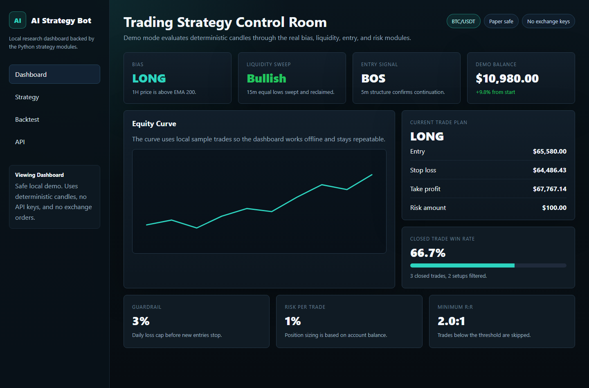
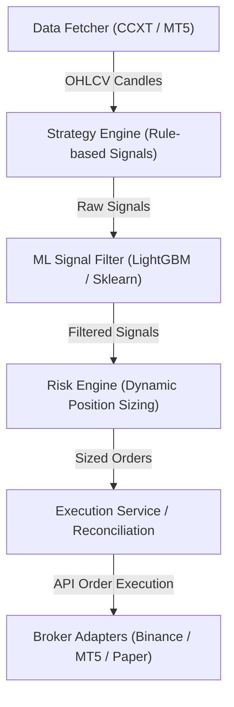

# Algorithmic Trading Bot Framework (ai-bot)

Modular algorithmic trading framework in Python with backtesting, MT5 & Binance adapters, ML signal filtering, and risk engine.



## Overview

**ai-bot** is an open-source, modular algorithmic trading and quantitative research system written in Python 3.11. Designed for rule-based strategy development and paper/live execution, it includes pluggable broker adapters (MetaTrader 5, Binance CCXT, Paper Trading), a backtesting engine with candle integrity checks, a Machine Learning signal filter (LightGBM / Scikit-Learn), and position sizing risk control.

## System Architecture



## Key Features

* **Multi-Broker Abstraction Layer**: Unified interface in `brokers/` supporting Binance (CCXT), MetaTrader 5 (MT5), and zero-risk Simulated Paper Trading.
* **Backtesting Engine**: Vectorized and event-driven backtesting module in `backtest/engine.py` with slippage, commission, and candle gap validation.
* **ML Signal Filtering**: Machine learning classifier (`ml/predictor.py`) trained on technical indicators to filter out low-probability trade signals.
* **Dynamic Position Sizing**: Volatility-adjusted (ATR) and account balance percentage risk models (`risk/sizing.py`).
* **Web Monitoring Dashboard**: Built-in web administration interface (`web_demo.py`) displaying live positions, P&L graphs, and signal metrics.

## Tech Stack

* **Language & Core**: Python 3.11, Pandas, NumPy
* **Trading & Market Data**: CCXT, MetaTrader5
* **Machine Learning**: LightGBM, Scikit-Learn
* **Web Dashboard**: Flask / Web server
* **Testing & Quality**: Pytest, Docker Compose

## Getting Started

### Prerequisites
* Python 3.11+
* Docker & Docker Compose (optional)

### Installation

1. Clone the repository:
   ```bash
   git clone https://github.com/flegardev/ai-bot.git
   cd ai-bot
   ```

2. Create virtual environment & install dependencies:
   ```bash
   python -m venv venv
   # Windows: venv\Scriptsctivate | Linux/macOS: source venv/bin/activate
   pip install -r requirements.txt
   ```

3. Configure environment variables:
   ```bash
   cp .env.example .env
   ```

4. Run the web monitoring demo:
   ```bash
   python web_demo.py
   ```

## Environment Variables

```env
TRADING_MODE=paper        # paper | live
BROKER=binance            # binance | mt5 | paper
BINANCE_API_KEY=your_api_key
BINANCE_API_SECRET=your_api_secret
RISK_PER_TRADE_PCT=1.5
```

## Running Tests

```bash
pytest
```

## License

This project is licensed under the MIT License.
