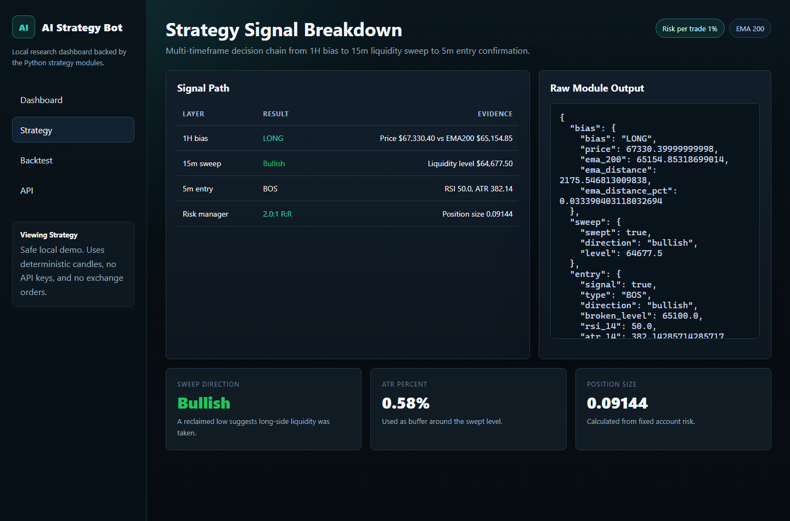
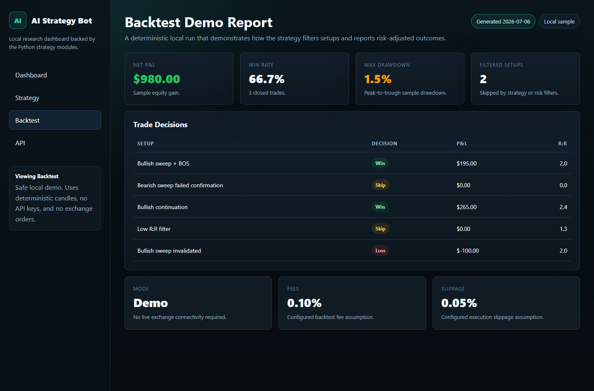

# Algorithmic Trading Bot Framework (ai-bot)

A modular algorithmic trading and quantitative backtesting framework in Python featuring MetaTrader 5 and Binance broker adapters, Scikit-Learn ML signal filtering, multi-gate execution safety, and local dashboard monitoring.

## Research reliability upgrade

See [RESEARCH_GUIDE.md](RESEARCH_GUIDE.md) for strict historical data checks, strategy rejection diagnostics,
delayed executable fills, completed-bar paper exits, purged ML training, baseline comparisons,
rolling forward evaluation, cost stress tests, and demo observation exports.

Profitability is unproven. A passing software test or a profitable historical sample does not approve live trading.
Research commands block incomplete history. Entry execution blocks stale, future, malformed, or overly wide quotes.
The guarded live command currently supports MT5 only. Binance remains available for research and paper data.


## Overview

**ai-bot** is an algorithmic trading framework designed for quantitative strategy research, historical backtesting, and rule-based execution. Written in Python 3.13, the architecture decouples market data ingestion, technical signal generation, machine learning probability scoring, risk calculation, and order execution.

The framework incorporates risk management controls including dynamic volatility position sizing, maximum drawdown triggers, spread/slippage thresholds, and an emergency software kill-switch. Real-money live trading requires three independent opt-in gates to eliminate unintended execution.

## Features

- **Multi-Broker Adapters**: Pluggable adapters for MetaTrader 5 (Windows desktop terminal), Binance (CCXT REST API with Testnet support), and deterministic in-memory paper trading.
- **Rule-Based & ML Signal Pipeline**: Combines technical market indicators (trend filters, breakout logic, EMA bias) with Scikit-Learn classification models to score trade execution probability.
- **Historical Backtesting Engine**: Replays historical OHLCV candle datasets with slippage simulation, spread models, equity curve tracking, and trade log exports.
- **Multi-Tier Risk Controls**: Volatility-adjusted position sizing, max daily loss limits, trailing drawdown boundaries, max concurrent positions, and stale price detection.
- **Software Emergency Kill-Switch**: Software-level emergency trading kill-switch (`python main.py kill-switch`) that cancels pending orders and locks the execution state.
- **Live Execution Safety Gates**: Requires three explicit confirmations (`ENABLE_LIVE_TRADING=true`, `I_UNDERSTAND_REAL_MONEY_RISK=true`, and CLI `--mode live`) before placing live broker orders.
- **Local Analytics Dashboard**: Built-in monitoring server (`python main.py dashboard`) visualizing recent trades, open positions, balance curves, and logs.

## Screenshots

| Trading Dashboard | Strategy Backtest & Analytics | Risk Controls & Positions |
|:---:|:---:|:---:|
|  |  |  |

## Tech Stack

- **Core Runtime**: Python 3.13+ (Asyncio, Typing, Dataclasses)
- **Quantitative & ML Libraries**: Pandas, NumPy, Scikit-Learn, Joblib
- **Brokers & Exchange APIs**: CCXT (Binance REST), MetaTrader5 Python API
- **Utilities & UI**: Python-Dotenv, Colorama, Native HTTP Dashboard
- **Quality & DevOps**: Pytest, Unittest, Ruff, Mypy, Docker

## Project Structure

```text
ai-bot/
├── backtest/                   # Historical simulation engine & metrics
├── brokers/                    # MT5, Binance (CCXT), and Paper broker adapters
├── core/                       # Strategy engine, signal models, and candle validators
├── data/                       # Market data fetchers and OHLCV stores
├── execution/                  # Order router and balance reconciliation
├── ml/                         # Scikit-learn signal classification models & training
├── persistence/                # SQLite/JSON state store for orders & executions
├── risk/                       # Position sizing, drawdown limits, and circuit breakers
├── strategy/                   # Concrete trading strategy implementations
├── tests/                      # Unit, mock broker, and safety test suites
├── _final_desktop_screenshots/ # Production UI screenshots
├── config.py                   # Centralized configuration & settings
├── Dockerfile                  # Worker container specification
├── main.py                     # Primary production CLI entrypoint
├── requirements.txt            # Direct pinned dependencies
└── web_demo.py                 # Embedded dashboard server
```

## Installation

### Prerequisites

- Python 3.12+ (CI covers 3.12, 3.13 and 3.14)
- (Optional) MetaTrader 5 terminal installed on Windows (for MT5 broker integration)

### Setup

1. **Clone the repository:**
   ```bash
   git clone https://github.com/flegardev/ai-bot.git
   cd ai-bot
   ```

2. **Create and activate a virtual environment:**
   ```bash
   python -m venv .venv
   # Windows (PowerShell):
   .venv\Scripts\Activate.ps1
   # Linux / macOS:
   source .venv/bin/activate
   ```

3. **Install dependencies:**
   ```bash
   pip install -r requirements.txt
   ```

4. **Configure environment variables:**
   ```bash
   cp .env.example .env
   ```

## Configuration

Configure trading rules and API credentials in `.env`:

```env
# Trading Mode: 'paper', 'backtest', or 'live'
TRADING_MODE=paper
BROKER=mt5
ENABLE_LIVE_TRADING=false
I_UNDERSTAND_REAL_MONEY_RISK=false

# MetaTrader 5 (Windows)
MT5_LOGIN=
MT5_PASSWORD=
MT5_SERVER=
MT5_TERMINAL_PATH=
MT5_SYMBOL=EURUSD
MT5_MAGIC_NUMBER=260727

# Binance / CCXT
BINANCE_API_KEY=your_binance_api_key
BINANCE_API_SECRET=your_binance_api_secret
USE_TESTNET=true

# Risk Engine Thresholds
RISK_PER_TRADE=0.01
MIN_RISK_REWARD=2.0
MAX_OPEN_POSITIONS=1
MAX_DAILY_LOSS_PCT=0.03
MAX_DRAWDOWN_PCT=0.10
MAX_PORTFOLIO_RISK_PCT=0.03
MAX_SPREAD=0.0005
MAX_SLIPPAGE=0.0005
STALE_PRICE_SECONDS=120

# Backtest Window
BACKTEST_START=2024-01-01
BACKTEST_END=2024-12-31
```

## Usage

The framework is operated via the CLI (`main.py`):

### 1. Verify Configuration & Environment
```bash
python main.py check
```

### 2. Run a Historical Backtest
```bash
# Run backtest over configured dates
python main.py backtest --start 2024-01-01 --end 2024-12-31

# Run backtest and train the ML filter
python main.py backtest --train-ml
```

`--train-ml` now trains from feature-complete, unfiltered rule trades when there are enough samples.
It reports insufficient samples explicitly. It does not invent trades or bypass the data-quality gate.

### 3. Run Real-Time Paper Trading (Safe Default)
```bash
# Continuous execution loop
python main.py paper --broker mt5 --symbol EURUSD

# Single completed-candle cycle
python main.py paper --once
```

### 4. Launch Analytics Dashboard
```bash
python main.py dashboard --port 8000
```
Visit [http://localhost:8000](http://localhost:8000) to view active positions and performance charts.

### 5. Software Emergency Kill-Switch
```bash
# Halt trading and cancel pending orders
python main.py kill-switch --cancel-pending

# Reset kill-switch and resume operational state
python main.py reset-kill-switch
```

## Testing & Quality Assurance

```bash
# Run unit and risk simulation tests
pytest

# Alternative test runner
python -m unittest discover -s tests -v

# Code quality and formatting checks
ruff check .
mypy .
```

## Docker Deployment

Run the trading bot in paper mode as an isolated background container:

```bash
docker build -t ai-bot .
docker run -d --name ai-bot --env-file .env -v ai-bot-state:/app/state ai-bot
```

## License & Portfolio Notice

Copyright (c) 2026 Tini Flegar. All rights reserved.
Source code is published for portfolio inspection and demonstration purposes.
